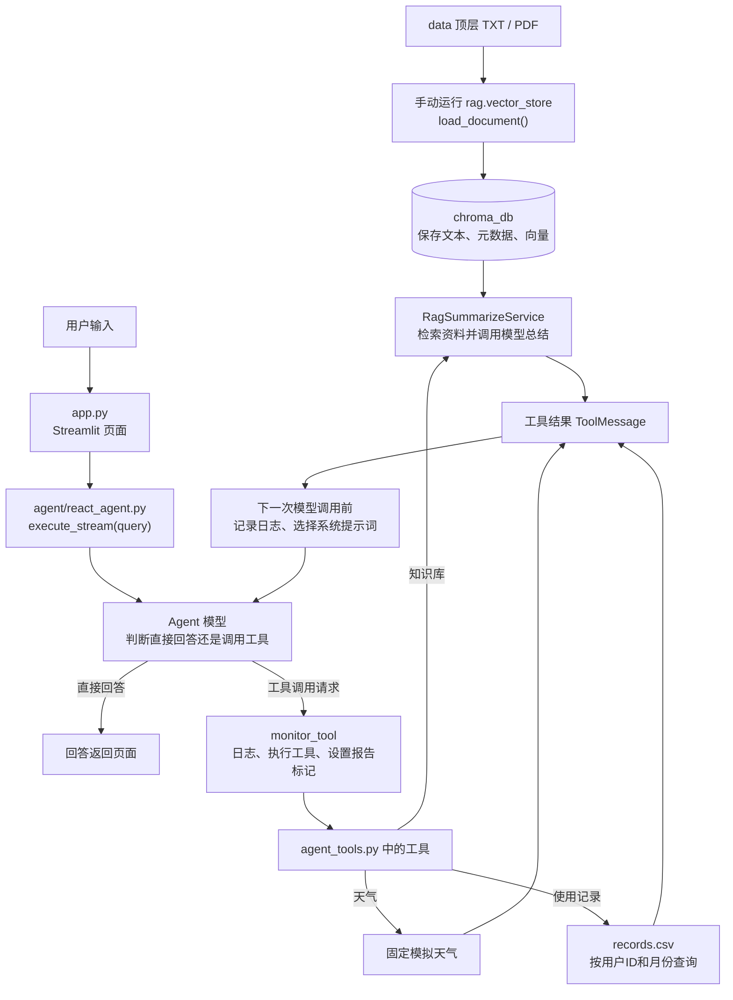
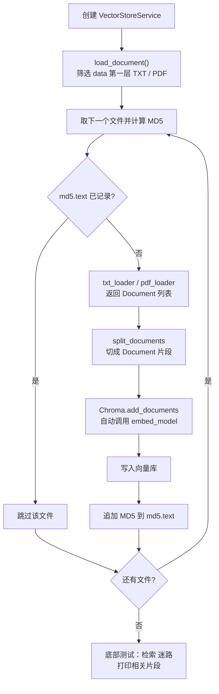
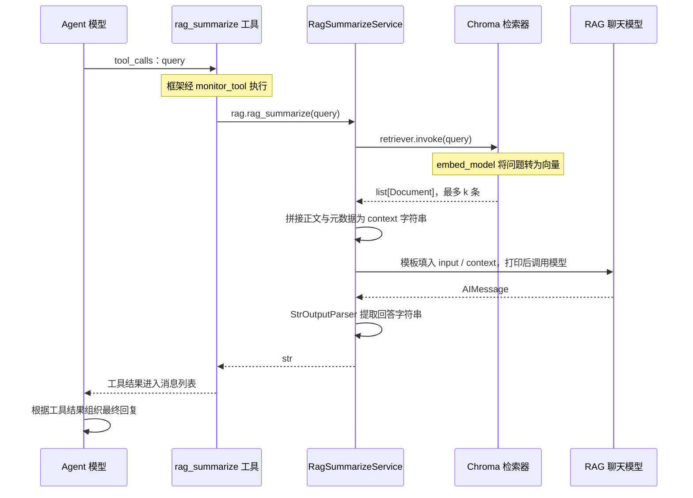
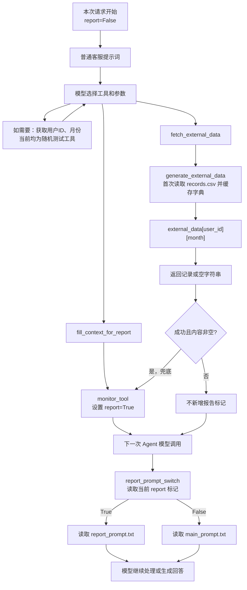

# 智扫通 Agent 项目调用流程

本文对应 `D:\project-ai\项目` 的实际代码（2026-10-18），课程参考目录不参与这里的运行。用于复习文件职责、调用顺序和数据类型。

## 1. 先看全局

项目有两条独立入口：先运行入库程序准备资料，再启动网页接收问题。网页不会自动执行文档入库。



图中的工具分支由模型选择，不是每次提问都执行全部工具。可以一次请求多个工具，也可能多轮调用。

## 2. 文件职责

| 文件 | 负责什么 | 不负责什么 |
|---|---|---|
| `app.py` | 接收输入、显示消息、保存页面会话状态 | 不实现检索和报告计算 |
| `agent/react_agent.py` | 组装模型、工具、中间件；启动 Agent 流 | 不读取 CSV 或解析 PDF |
| `agent/tools/agent_tools.py` | 定义供 Agent 调用的工具 | 不决定页面布局 |
| `agent/tools/middleware.py` | 监控工具、记录模型调用、动态选择系统提示词 | 不代替模型生成报告 |
| `rag/rag_service.py` | 根据问题检索文档、拼接资料、调用模型总结 | 不自动导入新资料 |
| `rag/vector_store.py` | 文档入库、MD5 查重、提供检索器 | 不直接生成聊天回答 |
| `model/factory.py` | 创建 `chat_model` 和 `embed_model` 客户端 | 不训练或下载模型 |
| `utils/config_handler.py` | 读取四份 YAML，得到配置字典 | 不创建模型 |
| `utils/path_tool.py` | 根据项目位置拼接绝对路径 | 不读取目标文件内容 |
| `utils/prompt_loader.py` | 根据配置读取三份提示词，返回字符串 | 不填充模板变量 |
| `utils/file_handler.py` | MD5、文件筛选、TXT/PDF 加载 | 不执行聊天 |
| `utils/logger_handler.py` | 配置终端和文件日志 | 不参与业务判断 |

当前 `factory.py` 直接写了 `qwen3.5:9b`、`qwen3-embedding:4b`，还没有用 `rag_conf` 创建模型。因此仅修改 `rag.yml` 的模型名称不会改变实际模型。

## 3. 网页启动时先做什么

1. `app.py` 导入 `ReactAgent`。
2. `react_agent.py` 导入模型、工具和中间件。
3. 导入 `agent_tools.py` 时，模块顶层的 `rag = RagSummarizeService()` 会执行。
4. RAG 服务创建 `VectorStoreService`，打开或创建 Chroma 集合，准备分割器和检索器；读取 RAG 提示词，组装执行链。此时不执行 `load_document()`。
5. 相关模块导入 `config_handler.py` 时，它会读取四份配置文件。模型客户端也在其模块导入时创建。
6. 页面显示标题。若当前会话尚无 Agent，执行 `ReactAgent()`，通过 `create_agent(...)` 组装 Agent，保存到 `st.session_state['agent']`。
7. 重画已保存的聊天记录，等待输入。

这里描述的是首次初始化时的依赖关系。Python 会缓存已导入模块；Streamlit 重新执行页面不等于每次都重新执行所有模块顶层代码。

## 4. 文档入库流程

在项目根目录运行：

```powershell
& "C:\Users\l\anaconda3\envs\yang_3_9\python.exe" -m rag.vector_store
```



读取、切分或入库抛出的异常会记录日志，再继续下一个文件；无有效文档或分片也会跳过，不保存该文件的 MD5。

当前配置：集合 `agent`，每段目标大小 200 字符，重叠 20 字符，检索最多返回 3 个片段。TXT/PDF 存进向量库，`external/records.csv` 不走这条流程。

`persist_directory: chroma_db` 当前是相对路径，所以入库程序和网页都应从 `D:\project-ai\项目` 启动。MD5 只记录已处理内容；修改文件后再入库会新增片段，当前没有删除旧版本片段的机制。

## 5. 一次网页提问的执行顺序

1. `st.chat_input()` 得到问题字符串 `prompt`。
2. `app.py` 显示并保存用户消息，调用 `agent.execute_stream(prompt)`。
3. `execute_stream` 只把本次问题包装为 `messages`，启动 `self.agent.stream(..., stream_mode='values', context={'report': False})`。
4. 每次 Agent 模型调用前，`log_before_model` 记录消息数量；`report_prompt_switch` 根据本次上下文选择系统提示词。
5. 模型返回普通回答，或返回带 `tool_calls` 的 `AIMessage`。
6. 有工具调用时，框架经过 `monitor_tool`；其中 `handler(request)` 继续实际工具执行，结果作为 `ToolMessage` 进入消息列表。随后再次调用模型，直到完成或报错。
7. `values` 返回阶段性完整状态。`execute_stream` 仅取 `chunk['messages'][-1]`，正文非空就 `yield` 字符串。
8. 页面 `capture()` 保存每段，再逐字符延迟显示。最后只把 `response_messages[-1]` 保存为助手消息，并调用 `st.rerun()` 重画页面。

这不是模型 token 级流式输出，而是阶段性结果加页面打字效果。只取最后一条可能漏显示同阶段的其他工具结果；也可能展示用户消息和工具正文，不保证只展示最终答案。

页面保存的历史只用于展示。当前没有把整个历史传回 Agent，也没有配置 Agent 持久化记忆，因此下一次提问不是自动延续上一次模型对话。若执行无正文返回，`response_messages[-1]` 也缺少空列表保护。

## 6. 知识库工具内部还有一次模型调用



RAG 链为：`prompt_template | print_prompt | model | StrOutputParser()`。

Agent 模型负责决定行动和最终回复；RAG 内部模型负责根据片段总结。当前两者引用同一个 `chat_model` 客户端，但发生在不同调用中。Agent 注册的模型中间件不自动包住 RAG 服务内部的普通模型调用。

三份提示词的分工：`main_prompt.txt` 是 Agent 普通系统要求；`report_prompt.txt` 是 Agent 报告系统要求；`rag_summarize.txt` 是 RAG 子链的填空模板，不由 `report` 标记切换。

## 7. 报告生成：CSV 数据和提示词切换



模型决定具体工具次序；主提示词要求先调用报告准备工具，但不构成程序级强制顺序。目前增加了“记录查询成功后开启报告模式”的兜底，避免模型漏掉准备工具。报告模式在同一次请求内保留；下一次 `execute_stream` 又从 False 开始。

`generate_external_data()` 把 CSV 整理成 `{用户ID: {月份: 记录字典}}`，首次需要时加载到进程内存。文件修改后已有缓存不会自动更新，重启可重新加载。它使用简单逗号拆分，不是完整 CSV 解析器。

`fetch_external_data` 虽标注返回 `str`，成功时实际返回字典，框架将其转换为工具消息内容；查询无结果则返回空字符串。

## 8. 当前边界与复习重点

- 天气是固定模拟数据；位置、用户ID和月份随机选择，未连接真实天气接口或登录系统。
- CSV 提供使用记录；向量库提供说明书知识，两者用途不同。
- 报告由模型生成，提示词约束仍不能保证结论准确，需要核对数字和建议依据。
- 页面会话状态不是长期存储，也不等于模型记忆。
- 中间件注册后自动介入 Agent 执行；工具是否被选择通常由模型决定。RAG 内部调用是另一条执行链。

先能讲清以下路线即可，不用背全部代码：

> 我先把 TXT/PDF 切分并向量化存到 Chroma。网页收到问题后，Agent 根据工具说明选择天气、RAG 或使用记录工具。工具调用经过中间件记录日志；RAG 先检索再调用模型总结，报告则按用户与月份查询 CSV 并动态切换系统提示词。最后 Agent 生成回复，由 Streamlit 显示。

## 9. 两条运行命令

均先切换到 `D:\project-ai\项目`，并确保 Ollama 已启动、有两个对应模型。

入库和检索测试：

```powershell
& "C:\Users\l\anaconda3\envs\yang_3_9\python.exe" -m rag.vector_store
```

启动网页：

```powershell
& "C:\Users\l\anaconda3\envs\yang_3_9\python.exe" -m streamlit run app.py
```
