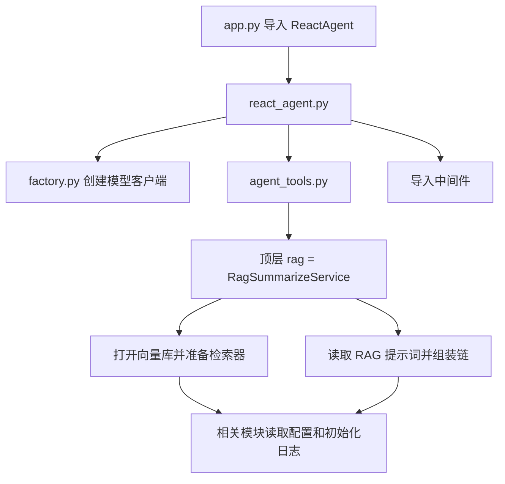
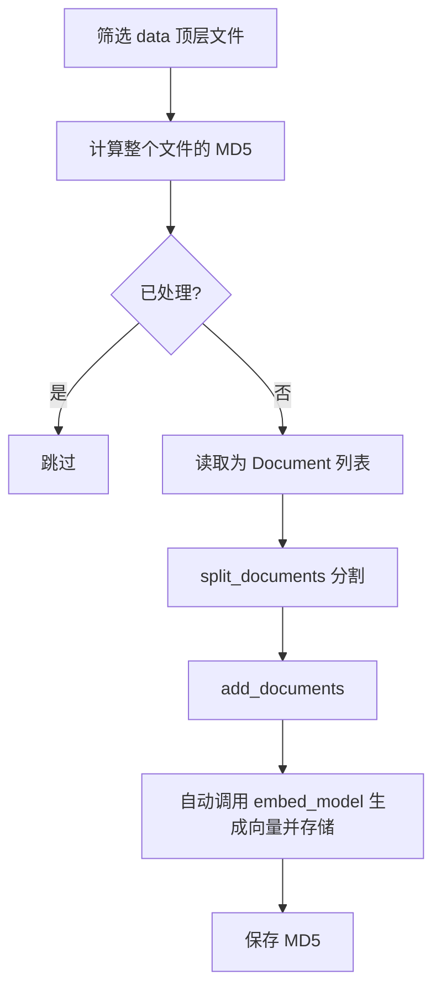
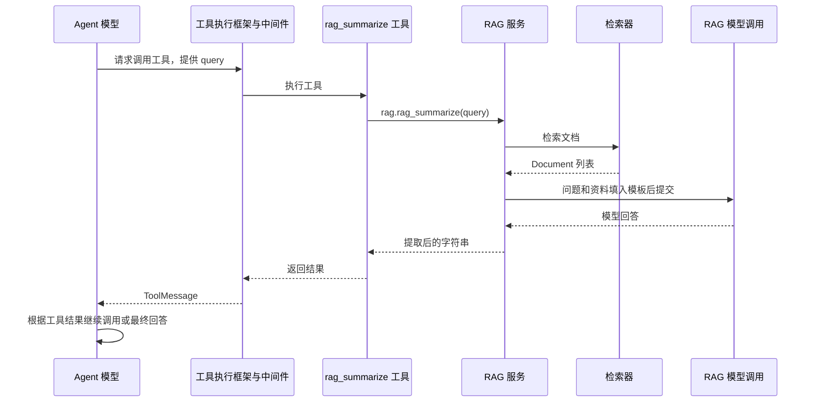
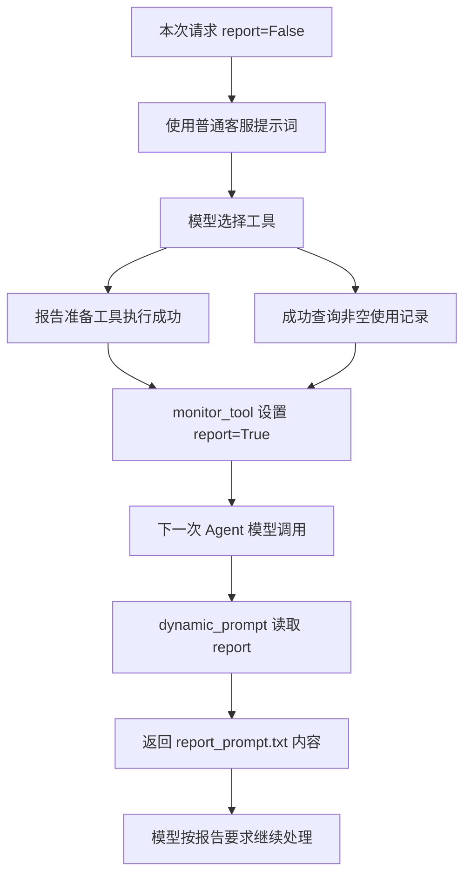

# 智扫通 Agent：从网页到工具的逐步讲解

本讲义只对应你正在写的 `D:\project-ai\项目`，以 2026-10-18 保存的代码为准。课程参考目录只用于学习，不参与以下调用。

这是配合 [项目调用流程总览](项目调用流程.md) 的详细阅读版。代码片段省略了部分注释、日志或参数，请以链接中的源文件为准。链接行号对应当前版本，后续修改可能发生移动。

建议每次只读一节：先看目的，再看代码，最后用自己的话解释输入和输出。不用背整份项目。

## 第一步：分清三个入口

| 入口 | 用途 | 对应文件 |
|---|---|---|
| `python -m streamlit run app.py` | 启动网页 | [app.py](app.py) |
| `python -m rag.vector_store` | 加载知识库并测试检索 | [vector_store.py](rag/vector_store.py#L91) |
| `python -m agent.react_agent` | 不开网页，在终端测试 Agent | [react_agent.py](agent/react_agent.py#L33) |

这些命令都应在 `D:\project-ai\项目` 目录执行。实际使用指定解释器 `C:\Users\l\anaconda3\envs\yang_3_9\python.exe`。

`if __name__ == '__main__':` 内的代码仅在文件作为入口运行时执行。导入 `vector_store.py` 不会执行底部的文档入库。

## 第二步：网页怎样准备 Agent

源文件：[app.py](app.py)。

```python
from agent.react_agent import ReactAgent

st.title("智扫通机器人智能客服")
st.divider()

if "agent" not in st.session_state:
    st.session_state["agent"] = ReactAgent()
```

`st.title`、`st.divider` 是页面显示。`st.session_state` 用于在当前网页会话中保留数据。用户交互会触发 Streamlit 重新执行页面代码，但已有 `agent` 就不再次创建。

`ReactAgent()` 创建的是我们自己的包装对象，自动执行 [ReactAgent.__init__()](agent/react_agent.py#L10)：

```python
self.agent = create_agent(
    model=chat_model,
    system_prompt=load_system_prompts(),
    tools=[rag_summarize, get_weather, get_user_location,
           get_user_id, get_current_month, fetch_external_data,
           fill_context_for_report],
    middleware=[monitor_tool, log_before_model, report_prompt_switch],
)
```

这里在组装模型、默认提示词、工具、中间件，还没有开始回答问题。

```text
st.session_state['agent'] → 我们写的 ReactAgent 对象
                               └─ self.agent → LangChain 创建的可执行 Agent
```

注意：`app.py` 导入的是 `agent/react_agent.py`。另一个 `agent/tools/react_agent.py` 当前不是这条入口的实际导入目标。

## 第三步：导入时，哪些准备已经发生

导入类不等于创建该类对象，但导入模块会执行其顶层代码，并按依赖导入其他模块。



首次导入 `agent_tools.py` 就会创建 RAG 服务，所以即使只问天气，缺少 RAG 配置也可能让整个页面启动失败。Python 通常会缓存已导入的模块；不是页面每次重画都重新执行所有模块顶层代码。

## 第四步：配置和路径从哪里来

源文件：[path_tool.py](utils/path_tool.py)、[config_handler.py](utils/config_handler.py)。

### 找到项目位置

[get_project_root()](utils/path_tool.py#L3) 的关键代码：

```python
current_file = os.path.abspath(__file__)
current_dir = os.path.dirname(current_file)
project_root = os.path.dirname(current_dir)
return project_root
```

从 `utils/path_tool.py` 往上两层，得到“项目”目录。[get_abs_path()](utils/path_tool.py#L8) 再拼接具体路径：

```python
return os.path.join(get_project_root(), relative_path)
```

输入 `"config/chroma.yml"`，输出指向该文件的绝对路径字符串。这里只拼路径，不读取文件，也不检查目标是否存在。

### 把 YAML 读成字典

以 [load_chroma_config()](utils/config_handler.py#L8) 为例：

```python
def load_chroma_config(config_path=get_abs_path("config/chroma.yml")):
    with open(config_path, "r", encoding="utf-8") as f:
        return yaml.load(f, Loader=yaml.FullLoader)

chroma_conf = load_chroma_config()
```

`k: 3` 解析后是字典中的 `"k": 3`，之后通过 `chroma_conf['k']` 取值。

| 读取函数 | 结果变量 | 配置文件 |
|---|---|---|
| [load_rag_config](utils/config_handler.py#L4) | `rag_conf` | [rag.yml](config/rag.yml) |
| [load_chroma_config](utils/config_handler.py#L8) | `chroma_conf` | [chroma.yml](config/chroma.yml) |
| [load_prompts_config](utils/config_handler.py#L12) | `prompts_conf` | [prompts.yml](config/prompts.yml) |
| [load_agent_config](utils/config_handler.py#L16) | `agent_conf` | [agent.yml](config/agent.yml) |

模块底部会直接调用四个函数，因此首次导入时四份文件都需要存在。`.yml` 和 `.yaml` 格式相同，但路径里的文件名必须与实际一致。

## 第五步：两个模型分别做什么

源文件：[factory.py](model/factory.py)。

```python
embed_model = OllamaEmbeddings(
    model="qwen3-embedding:4b",
    client_kwargs={"trust_env": False},
)

chat_model = ChatOllama(
    model="qwen3.5:9b",
    reasoning=False,
    client_kwargs={"trust_env": False},
)
```

| 对象 | 输入和用途 |
|---|---|
| [embed_model](model/factory.py#L3) | 把文本变成浮点数向量，用于入库和相似检索 |
| [chat_model](model/factory.py#L8) | 接收提示词或消息，生成回答、提出工具调用请求 |

`trust_env=False` 用于避免客户端采用环境代理配置；`reasoning=False` 是本地聊天模型的思考模式配置。创建客户端不会训练模型，也不会自动启动 Ollama。

当前模型名称直接写在这个 Python 文件里，并非来自 `rag_conf`。仅修改 `rag.yml` 目前不会切换实际模型。

## 第六步：三份提示词如何读取

源文件：[prompt_loader.py](utils/prompt_loader.py)。

以 [load_rag_prompts()](utils/prompt_loader.py#L20) 为例，忽略错误处理后的核心是：

```python
filepath = get_abs_path(prompts_conf["rag_summarize_prompt_path"])
return open(filepath, "r", encoding="utf-8").read()
```

第一个 `try` 获取配置路径，缺键时捕获 `KeyError`；第二个 `try` 真正打开文件。`logger.error` 记录错误，`raise e` 继续抛出异常，不是正常返回值。

| 函数 | 返回的文字来自哪里 | 谁使用 |
|---|---|---|
| [load_system_prompts](utils/prompt_loader.py#L6) | [main_prompt.txt](prompts/main_prompt.txt) | Agent 普通模式 |
| [load_rag_prompts](utils/prompt_loader.py#L20) | [rag_summarize.txt](prompts/rag_summarize.txt) | RAG 子链模板 |
| [load_report_prompts](utils/prompt_loader.py#L34) | [report_prompt.txt](prompts/report_prompt.txt) | Agent 报告模式 |

三个函数的返回值都是 `str`，不是模板对象，也不是模型回答。

## 第七步：先准备知识库——文件入库

源文件：[VectorStoreService](rag/vector_store.py#L11)。

### 初始化只准备对象

[__init__()](rag/vector_store.py#L12)：

```python
self.vector_store = Chroma(
    collection_name=chroma_conf["collection_name"],
    embedding_function=embed_model,
    persist_directory=chroma_conf["persist_directory"],
)
```

分别指定集合名、嵌入模型、保存目录。还会创建 `RecursiveCharacterTextSplitter`，根据配置设置 200 字符分块、20 字符重叠及优先分隔符。它准备好分割器，但此时没有切任何文档。

### load_document 才执行入库

[load_document()](rag/vector_store.py#L28) 内部的辅助函数：

- `check_md5_hex(md5)`：查 `md5.text` 中有没有这个指纹。
- `save_md5_hex(md5)`：成功入库后追加指纹。
- `get_file_documents(path)`：按 TXT/PDF 选择加载器。

主要调用关系：



文件工具都在 [file_handler.py](utils/file_handler.py)：

| 函数 | 输入 → 输出 | 关键实现 |
|---|---|---|
| [get_file_md5_hex](utils/file_handler.py#L7) | 文件路径 → MD5 字符串或 None | `rb` 读取，每次 4096 字节调用 `update`，最后 `hexdigest` |
| [listdir_with_allowed_type](utils/file_handler.py#L32) | 目录、允许后缀 → 路径元组 | `os.listdir`、`endswith`、`os.path.join` |
| [pdf_loader](utils/file_handler.py#L44) | PDF 路径 → Document 列表 | `PyPDFLoader(...).load()` |
| [txt_loader](utils/file_handler.py#L48) | TXT 路径 → Document 列表 | `TextLoader(...).load()` |

`Document.page_content` 是正文，`Document.metadata` 是来源等信息。MD5 是整个文件内容的指纹，不是每个分片一个 MD5。入库失败不记为成功；更新资料后当前实现会新增片段，不会自动删除旧片段。

当前 Chroma 路径 `chroma_db` 是相对启动目录，入库和网页必须使用相同项目根目录。其他通过 `get_abs_path` 处理的路径则以文件确定的项目位置为准。

## 第八步：从向量库拿到检索器

[get_retriever()](rag/vector_store.py#L25)：

```python
def get_retriever(self):
    return self.vector_store.as_retriever(
        search_kwargs={"k": chroma_conf["k"]}
    )
```

这一步返回检索器，不立即查询，也不复制数据库。

```python
docs = retriever.invoke("机器人跨越门槛失败怎么办？")
```

才会通过嵌入模型把问题变成向量，在库中查找，最多返回配置的 3 个 `Document`。`k=3` 是数量，不是相似度阈值。

## 第九步：RAG 服务怎样根据资料回答

源文件：[rag_service.py](rag/rag_service.py)。

[RagSummarizeService.__init__()](rag/rag_service.py#L16) 准备向量库、检索器、模板和聊天模型：

```python
self.prompt_text = load_rag_prompts()
self.prompt_template = PromptTemplate.from_template(self.prompt_text)
self.model = chat_model
self.chain = self._init_chain()
```

`prompt_text` 是字符串；`from_template` 创建识别 `{input}`、`{context}` 的模板对象，不改变原字符串。

[_init_chain()](rag/rag_service.py#L26)：

```python
return self.prompt_template | print_prompt | self.model | StrOutputParser()
```

组装时不回答；调用 `chain.invoke` 时才填模板并调用模型。

[print_prompt()](rag/rag_service.py#L9) 打印填好的提示词，最后 `return prompt` 原样传递。聊天模型返回消息，`StrOutputParser` 从中提取回答字符串，不负责核实事实。

[rag_summarize()](rag/rag_service.py#L34) 的核心：

```python
context_docs = self.retriever_docs(query)
context = ""
counter = 0
for doc in context_docs:
    counter += 1
    context += f"【参考资料{counter}】: 参考资料：{doc.page_content} | 参考元数据：{doc.metadata}\n"
return self.chain.invoke({"input": query, "context": context})
```

[retriever_docs()](rag/rag_service.py#L31) 只是调用 `self.retriever.invoke(query)`。

```text
query: str
  → context_docs: list[Document]
  → context: str
  → 模板填空后的提示词
  → AIMessage
  → 回答 str
```

## 第十步：把已有功能登记成工具

源文件：[agent_tools.py](agent/tools/agent_tools.py)。

[rag_summarize 工具](agent/tools/agent_tools.py#L17)：

```python
rag = RagSummarizeService()

@tool(description="从向量存储中检索参考资料")
def rag_summarize(query: str) -> str:
    return rag.rag_summarize(query)
```

外层是供模型选择的工具；`rag.rag_summarize` 是 RAG 对象的方法，名称相同不代表递归。`@tool` 整理名称、说明、参数结构；Agent 通过 `tools=[...]` 注册它。模型发出请求，框架执行 Python 函数。



这里有 Agent 和 RAG 两个模型调用位置，当前共用同一个聊天客户端。Agent 的模型中间件不会自动覆盖 RAG 内部的普通模型调用。

其余简单工具：

| 函数链接 | 实际行为 |
|---|---|
| [get_weather](agent/tools/agent_tools.py#L21) | 拼接城市名，返回固定晴天、26℃等模拟数据 |
| [get_user_location](agent/tools/agent_tools.py#L25) | 随机选深圳、合肥、杭州 |
| [get_user_id](agent/tools/agent_tools.py#L30) | 随机选择测试用户 ID |
| [get_current_month](agent/tools/agent_tools.py#L35) | 随机选 2025 年某个月，不读取实际日期 |

## 第十一步：CSV 使用记录怎样读取

[generate_external_data()](agent/tools/agent_tools.py#L39) 是普通辅助函数，没有 `@tool`。

```python
if not external_data:
    external_data_path = get_abs_path(agent_conf["external_data_path"])
    with open(external_data_path, "r", encoding="utf-8") as f:
        for line in f.readlines()[1:]:
            arr = line.strip().split(",")
            # 从 arr[0] 到 arr[5] 提取六列并移除双引号
```

`external_data` 初始为空；首次需要时才读 CSV。`[1:]` 跳过表头。每一行的字段最终存成：

```python
if user_id not in external_data:
    external_data[user_id] = {}

external_data[user_id][time] = {
    "特征": feature,
    "效率": efficiency,
    "耗材": consumables,
    "对比": comparison,
}
```

结构是：`用户ID → 月份 → 使用记录`。先建用户这一层，是为了避免不存在的键引发错误。

[fetch_external_data()](agent/tools/agent_tools.py#L75) 才是 Agent 工具：

```python
generate_external_data()
try:
    return external_data[user_id][month]
except KeyError:
    # 记日志
    return ""
```

用户或月份不存在时返回空字符串。虽然标注 `-> str`，查到记录时实际返回字典；类型标注不会自动转换结果。框架会把结果装进工具消息。

原始文件：[records.csv](data/external/records.csv)。它不进入向量库。当前简单 `split(',')` 不支持字段内逗号等复杂 CSV；修改文件后，已有的进程内缓存也不会自动重载。

## 第十二步：工具执行时中间件做什么

源文件：[middleware.py](agent/tools/middleware.py)。

[monitor_tool()](agent/tools/middleware.py#L12) 用 `@wrap_tool_call` 登记为工具调用中间件。理解版：

```python
def monitor_tool(request, handler):
    # 记录工具名称和参数
    result = handler(request)
    # 记录成功；必要时设置 report 标记
    return result
```

- `request`：这次调用的任务信息，包含 `tool_call['name']`、`tool_call['args']` 和运行上下文。
- `handler`：框架给的继续执行入口，不一定是原始工具函数本身。
- `handler(request)`：继续真正的工具调用。
- `return result`：把工具结果交回执行流程。

`Callable[[ToolCallRequest], ToolMessage | Command]` 是类型标注：可调用对象，接收请求，返回工具消息或状态更新命令。这里 `|` 是类型的“或者”，不是链连接。

`@tool` 的函数需要模型选择；注册的 `@wrap_tool_call` 中间件在 Agent 执行工具时自动介入。普通 Python 直接调用业务函数不会自动经过 Agent 中间件。

[log_before_model()](agent/tools/middleware.py#L40) 用 `@before_model` 在每次 Agent 模型调用前记录消息数量和最后一条内容，不决定模型答案。

## 第十三步：报告模式怎样切换

[fill_context_for_report()](agent/tools/agent_tools.py#L86) 只返回确认文字，本身不生成报告。中间件识别它之后设置：

```python
request.runtime.context["report"] = True
```

你自己的项目还加了兜底：`fetch_external_data` 返回成功且非空的 `ToolMessage` 时，也设置 True。

[report_prompt_switch()](agent/tools/middleware.py#L51)：

```python
@dynamic_prompt
def report_prompt_switch(request: ModelRequest):
    is_report = request.runtime.context.get("report", False)
    if is_report:
        return load_report_prompts()
    return load_system_prompts()
```

这不是让函数生成答案，而是在每次 Agent 模型调用前，决定使用哪段系统提示词。函数返回字符串，装饰器和框架把它用于本次模型调用。



主提示词要求的工具次序不是程序强制执行；兜底是因为已经观察到模型跳过报告准备工具。每次新的 `execute_stream` 都重新设置 False。天气查询不会设置报告标记。

报告提示词只约束生成，不能自动验证每一句事实，也不能保证模型完全遵守。

## 第十四步：用户问题真正进入执行

[execute_stream()](agent/react_agent.py#L19)：

```python
input_dict = {"messages": [{"role": "user", "content": query}]}
for chunk in self.agent.stream(
    input_dict, stream_mode="values", context={"report": False}
):
    latest_message = chunk["messages"][-1]
    if latest_message.content:
        yield latest_message.content.strip() + "\n"
```

`query` 是问题字符串；`messages` 是本次输入消息。`values` 表示每次输出阶段性的完整状态，`chunk['messages']` 是截至当前的消息列表。

```text
阶段一：[用户消息]
阶段二：[用户消息，模型工具请求]
阶段三：[用户消息，模型工具请求，工具结果]
阶段四：[用户消息，模型工具请求，工具结果，模型最终回答]
```

这是示意，实际可能有多工具、多轮执行。取 `[-1]` 是作者选择只显示最后一条，不是 `values` 只能返回一条。

`yield` 让函数成为生成器：外面迭代时逐段取得内容，而不是用一个 `return` 结束全部输出。每段的类型通常是 `str`。

## 第十五步：页面怎样显示、保存回答

回到 [app.py 输入与输出处理](app.py#L19)：

```python
prompt = st.chat_input()
if prompt:
    st.chat_message("user").write(prompt)
    st.session_state["message"].append({"role": "user", "content": prompt})
```

先显示用户问题并保存在页面会话中。`st.spinner` 在处理期间显示等待动画。

页面获取生成器：

```python
res_stream = st.session_state["agent"].execute_stream(prompt)
```

[capture 函数所在的 app.py](app.py#L29)：

```python
def capture(generator, cache_list):
    for chunk in generator:
        cache_list.append(chunk)
        for char in chunk:
            time.sleep(0.01)
            yield char
```

`generator` 接收 `res_stream`，`cache_list` 接收空列表 `response_messages`。整段先保存，再逐字符交给页面，制造打字效果；不是模型 token 级流式输出。

```python
st.chat_message("assistant").write_stream(capture(res_stream, response_messages))
st.session_state["message"].append({
    "role": "assistant", "content": response_messages[-1]
})
st.rerun()
```

显示后只保存最后一段为助手回复，`st.rerun()` 重新执行页面代码，前面的循环重画历史消息。

当前边界：

- `execute_stream` 不筛选消息类型，可能展示用户问题或工具正文；取最后一条也可能漏展示同阶段的其他工具结果。
- 没有返回任何正文时，`response_messages[-1]` 会报错，尚无空列表保护。
- 页面历史用于展示；`execute_stream` 只传本次问题，没有把页面历史交给模型，也没有配置持久化记忆。
- `session_state` 不是磁盘聊天数据库，刷新、新会话或服务重启时不能当作永久记录。

## 第十六步：日志先学会用，不必重写

源文件：[logger_handler.py](utils/logger_handler.py)，配置函数 [get_logger()](utils/logger_handler.py#L15)。

```python
from utils.logger_handler import logger

logger.info("开始查询")
logger.warning("没有找到记录")
logger.error("查询失败")
```

`logging` 是 Python 模块，`Logger` 是类，`logging.getLogger` 是获取对象的函数，`get_logger` 是项目作者写的配置函数，`logger` 是保存对象的变量。

日志器把消息交给终端、文件两个 Handler。默认终端显示 INFO 及以上，文件保存 DEBUG 及以上，附加时间和代码位置。日志记录发生了什么，不会自动修复失败。

## 最后：用三条路线检查自己是否理解

### 问天气

`app.py → execute_stream → 模型请求 get_weather → monitor_tool 执行 → ToolMessage → 模型回答 → 页面显示`

### 问说明书

`app.py → Agent → rag_summarize 工具 → RAG 服务 → 检索器找片段 → 模板填问题与资料 → RAG 模型总结 → Agent 接收结果并回答 → 页面显示`

### 生成使用报告

`app.py → Agent 获取用户和月份（或使用用户指定值） → 查询 CSV → 中间件开启报告模式 → 下一次模型调用改用报告提示词 → 生成报告 → 页面显示`

可能先调用报告准备工具，也可能由成功查询记录触发兜底；按实际工具调用日志判断，不能假定每次顺序完全一致。

这三条路线能讲清楚，再逐渐深入每个函数；不需要把整个类默写下来。
